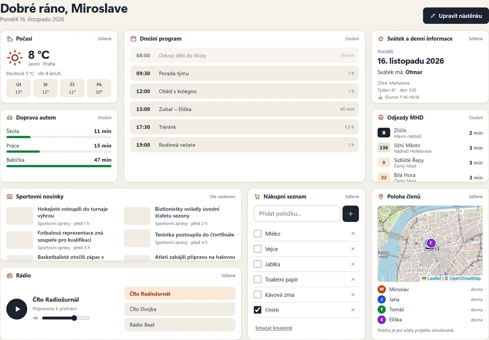

# DayBoard – rodinná nástěnka pro začátek dne

Webová aplikace v PHP, která slouží jako domovská stránka pro vstup do dne. Je určena pro jednu
domácnost a provozuje se na domácím serveru. Každý člen rodiny po přihlášení vidí vlastní nástěnku
složenou z widgetů (počasí, dnešní program, doprava, nákupní seznam…).

Skupinový projekt předmětu **Internetové technologie – client side** (PEF ČZU v Praze).
Zadání, informační architekturu, wireframy a SEO strategii popisuje úvodní studie projektu.



## Rychlý start

Potřebujete **PHP 8.1+** s rozšířeními `pdo_sqlite`, `mbstring`, `openssl`, `simplexml` a `curl`.
Žádný Composer, Node.js ani databázový server – databáze SQLite se vytvoří sama při prvním spuštění.

```bash
git clone https://github.com/matejkrsek/CZU_DayBoard.git
cd CZU_DayBoard
php -S localhost:8000 -t public public/index.php
```

Otevřete <http://localhost:8000>. Veřejná část je na úvodní adrese, aplikace na `/prihlaseni`.

### Ukázkové účty

Nová databáze obsahuje ukázkovou domácnost. Heslo všech účtů je `dayboard`.

| Přihlašovací jméno      | Jméno    | Role               |
|-------------------------|----------|--------------------|
| `miroslav@domacnost.cz` | Miroslav | Správce domácnosti |
| `jana@domacnost.cz`     | Jana     | Člen               |
| `tomas@domacnost.cz`    | Tomáš    | Člen               |
| `eliska@domacnost.cz`   | Eliška   | Host / dítě        |

Na přihlašovací stránce jsou v ukázkovém režimu tlačítka pro přihlášení jedním kliknutím.
Databázi vrátíte do výchozího stavu příkazem `php bin/reset-db.php`.

### Další způsoby spuštění

- **XAMPP / Apache** – naklonujte projekt do `htdocs` a otevřete `http://localhost/CZU_DayBoard/`.
  Je potřeba zapnutý `mod_rewrite`; o zbytek se postarají přiložené soubory `.htaccess`
  (kořenový přesměruje vše do `public/`, takže databáze ani `.env` nejsou z webu dostupné).
- **Docker** – `docker compose up -d` a otevřete <http://localhost:8080>. Data jsou ve svazku `dayboard-data`.

## Nasazení online (Render, zdarma)

Repozitář je připravený pro bezplatný tarif hostingu [Render](https://render.com) (soubor `render.yaml`).
Každý push do větve `main` pak automaticky nasadí novou verzi.

1. Na <https://render.com> se přihlaste účtem GitHub (platební karta není potřeba).
2. **New → Blueprint**, vyberte repozitář `CZU_DayBoard` a potvrďte **Apply**.
3. Po prvním sestavení (několik minut) běží web na adrese `https://dayboard-….onrender.com`.

Omezení bezplatného tarifu:

- Po **15 minutách bez návštěv se služba uspí**, první další návštěva čeká asi minutu.
- **Nemá trvalý disk:** po uspání, restartu nebo novém nasazení se databáze vytvoří znovu
  s ukázkovou domácností. Pro předvádění to stačí, pro skutečné používání ne.
  Aplikace na to upozorní na přihlašovací stránce (proměnná `EPHEMERAL_STORAGE=true`).

API klíče (Google, TomTom, Golemio) doplníte v Renderu v nastavení služby v části **Environment**.
U Google OAuth pak nastavte redirect URI na `https://VASE-ADRESA.onrender.com/nastaveni/google/callback`.

## Konfigurace

Aplikace běží i bez konfigurace. Pro vlastní nastavení zkopírujte `.env.example` jako `.env`:

| Klíč | Význam |
|------|--------|
| `APP_ENV` | `development` vypisuje chyby do prohlížeče, `production` jen do `storage/logs` |
| `APP_URL` | veřejná adresa webu (canonical, sitemap, návratová adresa OAuth); prázdné = odvodí se z požadavku |
| `DEMO_MODE` | `true` = ukázková tlačítka na přihlášení a ukázková data u widgetů bez klíče |
| `DB_PATH` | cesta k souboru SQLite (výchozí `storage/dayboard.sqlite`) |
| `GOOGLE_CLIENT_ID`, `GOOGLE_CLIENT_SECRET` | OAuth klient pro widget Dnešní program |
| `TOMTOM_API_KEY` | widget Doprava autem |
| `GOLEMIO_API_KEY` | widget Odjezdy MHD |

> **Ostrý provoz:** nastavte `DEMO_MODE=false`, `APP_ENV=production`, změňte hesla ukázkových účtů
> (nebo účty odeberte) a web zpřístupněte jen přes HTTPS.

### Widgety a jejich zdroje dat

| Widget | Zdroj | Co je potřeba |
|--------|-------|---------------|
| Počasí | [Open-Meteo](https://open-meteo.com) | nic |
| Svátek a denní informace | [svatkyapi.cz](https://svatkyapi.cz) | nic |
| Sportovní novinky | libovolný RSS / Atom zdroj | nic (výchozí zdroj nastavuje správce) |
| Rádio | katalog [Radio Browser](https://www.radio-browser.info) | nic |
| Nákupní seznam | vlastní databáze | nic |
| Poloha členů | **simulovaná** vlastní službou, mapa Leaflet + OpenStreetMap | nic |
| Dnešní program | Google Calendar API (OAuth 2.0) | OAuth klient Google |
| Doprava autem | TomTom Routing + Geocoding API | klíč TomTom |
| Odjezdy MHD | [Golemio API](https://api.golemio.cz/pid/docs/openapi/) | klíč Golemio |

Poslední tři widgety bez klíče zobrazují v ukázkovém režimu ukázková data (jsou tak označená).

**Google Kalendář:** v [Google Cloud Console](https://console.cloud.google.com) založte projekt,
povolte *Google Calendar API*, nastavte obrazovku souhlasu a vytvořte přihlašovací údaje typu
*OAuth client ID → Web application*. Jako *Authorized redirect URI* zadejte
`{APP_URL}/nastaveni/google/callback` (pro vývoj `http://localhost:8000/nastaveni/google/callback`).
Google přijímá jen adresy `localhost` nebo HTTPS s veřejnou doménou. Každý člen pak účet připojí
v Osobním nastavení; aplikace žádá pouze o čtení kalendáře.

## Co je hotové

- **Veřejná prezentační část** (SEO): Domů, Funkce a widgety, Jak to funguje, Soukromí a bezpečnost,
  Časté dotazy, Návody + tři články. Title, description, H1 a URL podle tabulek 5 a 6 studie,
  `sitemap.xml`, `robots.txt`, canonical, Open Graph, strukturovaná data. Stránky jsou bez JavaScriptu.
- **Přihlášení** s rolemi správce / člen / host‑dítě, „zůstat přihlášen“, vynucená změna dočasného hesla.
- **Nástěnka** – mřížka 4 sloupců, 9 widgetů, načítání AJAXem s kostrou (skeleton) a průběžnou obnovou.
- **Režim úprav** – přetahování, změna velikosti tažením za roh, přidání a odebrání widgetu;
  ovladatelné myší, dotykem i klávesnicí.
- **Osobní nastavení** – motiv (světlý / tmavý / podle systému), hustota mřížky, RSS zdroj,
  Google účet, cíle cest, oblíbené zastávky, sdílení polohy.
- **Správa domácnosti** – členové a role, povolené widgety pro členy a hosty, lokalita, časové
  pásmo, výchozí RSS, rozhlasové stanice.

### Oprávnění rolí

| Oblast | Správce | Člen | Host / dítě |
|--------|---------|------|-------------|
| Nástěnka | vlastní | vlastní | vybraná správcem |
| Výběr widgetů | všechny dostupné | z povolených správcem | ne |
| Úprava rozložení | ano | ano | ne |
| Osobní nastavení | ano | ano | jen vzhled, pokud to správce povolí |
| Správa domácnosti | ano | ne | ne |
| Nákupní seznam | přidávat i mazat | přidávat i mazat | jen přidávat (lze změnit) |

Matice oprávnění je na jednom místě v `src/Core/Auth.php` a ověřuje se na serveru při každé akci.

## Struktura projektu

```
public/              webový kořen – jediná složka dostupná z internetu
  index.php          front controller (vstupní bod všech požadavků)
  assets/css/        base.css (společné), site.css (veřejný web), app.css (aplikace)
  assets/js/         app.js, dashboard.js, dashboard-edit.js, settings.js, household.js
  assets/vendor/     Leaflet 1.9.4 (mapy), přibalený lokálně
src/
  App.php            routy, bezpečnostní hlavičky, zpracování chyb
  Core/              Router, Database, Auth (RBAC), Session, Csrf, Cache, Http, Crypto, View
  Controllers/       Public, Auth, Dashboard, Settings, Household, Api
  Models/            Users, Household, Layouts, Shopping
  Services/          Weather, Calendar, Traffic, Transit, Nameday, News, Radio, Location, Geocoding
  Widgets/           WidgetRegistry (katalog widgetů), WidgetRenderer
  Site/              Pages (veřejné stránky a jejich SEO metadata), Faq
  Support/           Czech (data, oslovení, skloňování), Icons (SVG ikony)
templates/           PHP šablony: layouts/, site/, app/, widgets/, partials/
database/schema.sql  schéma SQLite
storage/             databáze, cache odpovědí API, logy, šifrovací klíč (není v Gitu)
bin/reset-db.php     obnova ukázkové databáze
```

Bez frameworku a bez závislostí: třídy načítá jednoduchý autoloader (`src/bootstrap.php`),
jmenný prostor `DayBoard\X\Y` odpovídá souboru `src/X/Y.php`.

### Jak přidat nový widget

1. Přidejte záznam do `src/Widgets/WidgetRegistry.php` (název, ikona, výchozí velikost, `async`, interval obnovy).
2. Data připravte ve službě v `src/Services/` a doplňte větev do `WidgetRenderer::data()`.
3. Vytvořte šablonu `templates/widgets/{klíč}.php` a styly v `public/assets/css/app.css`.

Widget se sám objeví v nabídce režimu úprav i ve Správě domácnosti. Odpovědi externích API
obalte do `Cache::remember()` – stránka pak nečeká na cizí server a šetří se limity.

### Jak přidat veřejnou stránku

Záznam do `src/Site/Pages.php` (URL, title, description, H1), šablona v `templates/site/`
a routa v `src/App.php`. Do `sitemap.xml` se stránka zařadí sama.

## Zásady, které kód dodržuje

- **Bezpečnost:** hesla jako otisk (`password_hash`), CSRF token u všech formulářů i AJAXu,
  parametrizované SQL dotazy, escapování výstupu funkcí `e()`, Content-Security-Policy bez inline
  skriptů, omezení pokusů o přihlášení, tokeny Google šifrované v databázi, kontrola adres RSS
  proti přístupu do vnitřní sítě.
- **Rychlost (Core Web Vitals):** widgety mají předem rezervované místo, mapa a rádio se načítají
  až při zobrazení / kliknutí, skripty mají `defer`, odpovědi API se cachují na serveru.
- **Přístupnost:** sémantické HTML5, jeden H1 na stránku, viditelný fokus, ovládání klávesnicí
  včetně režimu úprav, popisky pro čtečky obrazovky, respektování `prefers-reduced-motion`.
- **Responzivita:** 4 sloupce na počítači, 2 na tabletu, 1 na telefonu; rozložení se ukládá jen jedno.

## Známá omezení

- Poloha členů je **simulovaná** (odvozuje se z denní doby), z telefonů se nic nesbírá.
- Fotoalbum je jen plánované rozšíření – v nabídce je vidět, ale nejde přidat.
- Rozhraní je pouze česky.
- Odjezdy MHD pokrývají Pražskou integrovanou dopravu (data Golemio).
- Widgety Dnešní program, Doprava autem a Odjezdy MHD byly bez API klíčů ověřeny jen
  s ukázkovými daty; volání skutečných API je napsané podle dokumentace služeb, ale v ostrém
  provozu ho zatím nikdo nevyzkoušel. Spuštění přes Docker je ověřené, přes XAMPP/Apache zatím ne.

## Řešení potíží

- **„V PHP chybí rozšíření…“** – v `php.ini` odkomentujte příslušné řádky `extension=…` a restartujte server.
- **Widgety hlásí chybu SSL certifikátu (Windows, PHP 8.1)** – stáhněte
  [cacert.pem](https://curl.se/docs/caextract.html) a v `php.ini` nastavte `curl.cainfo`.
  Od PHP 8.2 aplikace používá úložiště certifikátů Windows sama.
- **Po změně schématu databáze** – smažte `storage/dayboard.sqlite` nebo spusťte `php bin/reset-db.php`.
- **Chyby na produkci** – najdete je v `storage/logs/php-error.log`.

## O projektu

Skupinový studentský projekt; autoři a zadání jsou uvedeni v úvodní studii.
Knihovna Leaflet v `public/assets/vendor/leaflet` je šířena pod licencí BSD 2-Clause (viz soubor `LICENSE` tamtéž).
